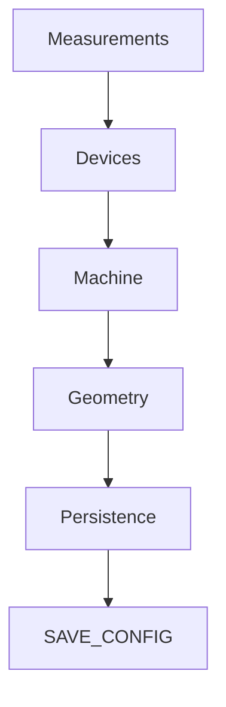

# Klipper Metrology Extension

Version: 0.5.0

---

# 1. Objetivo

Desenvolver uma extensão de metrologia para Klipper capaz de determinar,
armazenar e aplicar automaticamente a geometria real da impressora.

A extensão deve ser independente do modelo da máquina, permitindo futuras
adaptações para diferentes arquiteturas.

---

# 2. Princípios de Projeto

A arquitetura deve obedecer aos seguintes princípios:

- Separação entre medição e geometria.
- Objetos pequenos e bem definidos.
- Persistência independente da lógica.
- Cálculos centralizados.
- Nenhum comando deve alterar diretamente a configuração da impressora.
- Toda alteração permanente deverá passar pelo modelo geométrico da máquina.

---

# 3. Arquitetura

# 4. Objetos do Sistema

## Point3D

Representa uma coordenada tridimensional.

Campos:

- x
- y
- z

---

## Device

Representa um dispositivo físico.

Campos:

- name
- position

---

## Machine

Representa a geometria completa da impressora.

Responsável por concentrar todos os parâmetros físicos obtidos durante a calibração.

---

# 5. Fluxo Geral

Captura

↓

Conversão em Device

↓

Atualização da Machine

↓

Cálculos Geométricos

↓

Validação

↓

Persistência

↓

SAVE_CONFIG

---

# 6. Modelo Matemático

Cada parâmetro da máquina deve possuir:

- origem dos dados
- equação
- destino
- validação

---

# 7. Modelo Matemático

Todo parâmetro calculado pela extensão deve possuir uma definição formal contendo:

- origem dos dados
- dispositivos necessários
- equação utilizada
- destino na configuração do Klipper
- método responsável pelo cálculo

Nenhum valor deverá ser calculado diretamente pelos comandos G-Code. Todos os cálculos deverão estar centralizados no módulo `geometry.py`.

---

## 7.1 Origem da Mesa (Bed Origin)

| Item | Valor |
|------|-------|
| Nome | Bed Origin |
| Descrição | Coordenada física correspondente ao ponto (0,0) da superfície útil da mesa |
| Referência | Hotend RIGHT |
| Medições necessárias | RIGHT |
| Equação | Origem = posição do hotend RIGHT sobre o canto físico da mesa |
| Resultado | origin_x, origin_y |
| Destino | Configuração dos eixos X e Y |
| Responsável | geometry.py |

---

## 7.2 Offset do Hotend Esquerdo

| Item | Valor |
|------|-------|
| Nome | Left Hotend Offset |
| Descrição | Distância entre os dois hotends |
| Referência | RIGHT |
| Medições necessárias | RIGHT e LEFT |
| Equação | LEFT − RIGHT |
| Resultado | offset_x, offset_y, offset_z |
| Destino | Configuração do extrusor esquerdo |
| Responsável | geometry.py |

---

## 7.3 Offset da Sonda

| Item | Valor |
|------|-------|
| Nome | Probe Offset |
| Descrição | Distância entre a ponta da sonda e o hotend de referência |
| Referência | RIGHT |
| Medições necessárias | RIGHT e PROBE |
| Equação | PROBE − RIGHT |
| Resultado | probe_offset_x, probe_offset_y, probe_offset_z |
| Destino | Configuração da sonda |
| Responsável | geometry.py |

---

## 7.4 Área Útil de Impressão

| Item | Valor |
|------|-------|
| Nome | Printable Area |
| Descrição | Região efetivamente imprimível da máquina |
| Referência | Origem da mesa + dimensões físicas |
| Medições necessárias | Bed Origin + Bed Width + Bed Depth |
| Equação | Área = Origem + Dimensões |
| Resultado | print_min_x, print_min_y, print_max_x, print_max_y |
| Destino | position_min / position_max |
| Responsável | geometry.py |

---

## 7.5 Limites Mecânicos

| Item | Valor |
|------|-------|
| Nome | Machine Limits |
| Descrição | Limites absolutos de deslocamento dos eixos |
| Medições necessárias | Curso mecânico dos eixos |
| Resultado | x_min, x_max, y_min, y_max, z_min, z_max |
| Destino | Configuração dos steppers |
| Responsável | geometry.py |

---

## 7.6 Altura Relativa dos Hotends

| Item | Valor |
|------|-------|
| Nome | Relative Z Offset |
| Descrição | Diferença de altura entre os hotends |
| Referência | RIGHT |
| Medições necessárias | RIGHT e LEFT |
| Equação | ΔZ = LEFT.z − RIGHT.z |
| Resultado | offset_z |
| Destino | Configuração do extrusor esquerdo |
| Responsável | geometry.py |

---
# 8. Parâmetros da Máquina

A geometria completa da impressora deverá ser representada por um único objeto denominado `Machine`.

Esse objeto armazenará exclusivamente o resultado consolidado do processo de calibração.

| Grupo | Parâmetros |
|--------|------------|
| Bed | origin_x, origin_y, width, depth |
| Hotend RIGHT | x, y, z |
| Hotend LEFT | x, y, z |
| Probe | x, y, z |
| Offsets | hotend_left, probe |
| Limites | x_min, x_max, y_min, y_max, z_min, z_max |
| Área útil | print_min_x, print_max_x, print_min_y, print_max_y |
| Estado | calibration_version, timestamp |
