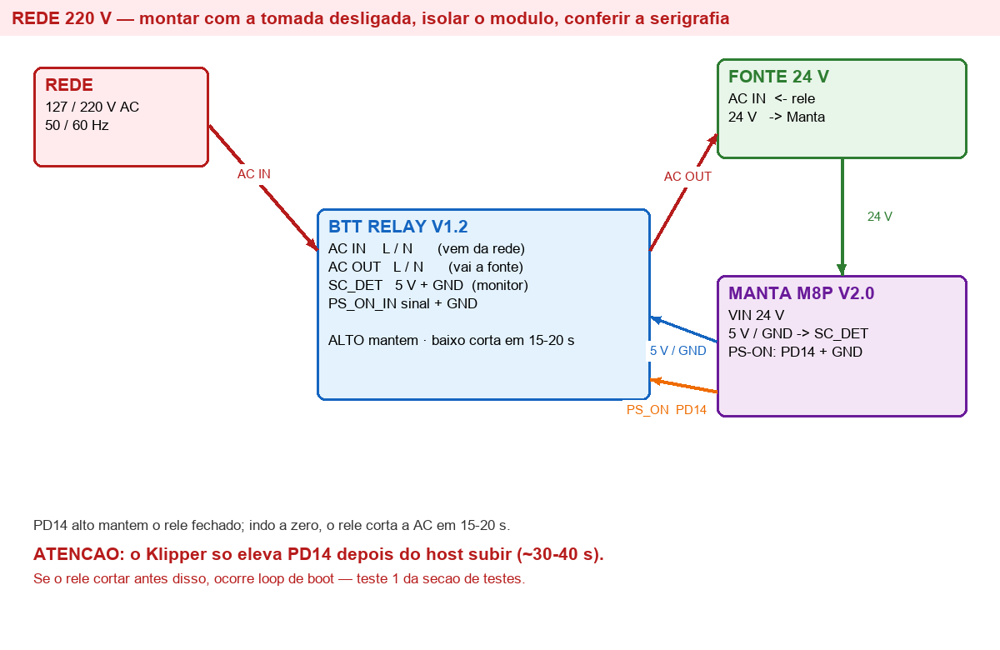

# Relé de Energia — BTT Relay V1.2 + Manta M8P V2.0

**Documento:** 15_Relay_Energia.md
**Versão:** 2.0.0
**Data:** 2026-10-27
**Objetivo:** desligar a impressora pelo painel, cortando a rede elétrica pelo relé.

> **PERIGO — RISCO DE CHOQUE ELÉTRICO E INCÊNDIO.** Intervenção na rede 220 V. Montar com a tomada
> desligada, isolar o módulo, conferir a serigrafia da placa. Sem habilitação para trabalho em
> instalações elétricas, execute a parte de rede com um eletricista.

---

# 1. Como a placa funciona

| Terminal | Função |
|---|---|
| `AC IN` (L / N) | entrada da rede — 85 a 265 V AC, 50/60 Hz |
| `AC OUT` (L / N) | saída que alimenta a fonte da impressora |
| `SC_DET` (5 V + GND) | monitora a linha de 5 V; curto ou perda de 5 V corta a energia |
| `PS_ON_IN` (sinal + GND) | controle: **nível ALTO mantém ligado**; ao cair, desliga em **15–20 s** |

MCU próprio (STC15W201S), lógica de 3,3 V ou 5 V, e atraso de 15–20 s que permite ao Linux encerrar.

# 2. Decisão: controle pelo `PS_ON` da Manta (PD14)

| Opção | Como funciona |
|---|---|
| **A — `PS_ON` da Manta (PD14)** ✅ adotada | o Klipper controla o pino; o relé corta após o sinal cair |
| B — GPIO da CB1 (PC8, pino 40) | o host mantém a linha alta; ao concluir o `poweroff`, a linha cai |

A opção A tem **duas consequências** que precisam estar claras:

**2.1 O MCU é alimentado pela mesma fonte que o relé corta.** Se o relé cortar primeiro, a CB1 morre
sem encerrar o sistema de arquivos. Por isso o desligamento é sempre em dois passos, dentro da
macro: **baixar o pino** (inicia o temporizador de 15–20 s) e **imediatamente pedir o `poweroff` do
host**. O temporizador é a rede de segurança — se o host travar, o corte acontece de todo modo, com
risco de corrupção do cartão.

**2.2 Janela de boot.** Ao aplicar rede, o relé fecha e começa a contar 15–20 s. O Klipper só eleva
`PD14` depois que o host sobe e carrega a configuração — tipicamente **30–40 s** na CB1. Se o relé
cortar antes disso, o sistema entra em **loop de boot**.
O firmware publicado pela BTT não tem variante com atraso maior (o repositório traz um único
`STC15W201S.hex`). O **teste 1** da seção 8 responde se isso ocorre na prática.

# 3. Diagrama



# 4. Ligações, ponto a ponto

| # | Origem | Destino | Observação |
|---|---|---|---|
| 1 | Rede — fase | `AC IN` (L) | após fusível/disjuntor |
| 2 | Rede — neutro | `AC IN` (N) | manter polaridade |
| 3 | `AC OUT` (L/N) | entrada AC da fonte 24 V | é a fonte que será comutada |
| 4 | `SC_DET` (5 V + GND) | `5V` e `GND` **da Manta** | monitor de curto |
| 5 | `PS_ON_IN` sinal | **`PS-ON` da Manta — PD14** | 3,3 V |
| 6 | `PS_ON_IN` GND | GND da Manta | referência comum |
| 7 | — | CB1 pino 40 | **não usado** nesta opção |

# 5. Software

## 5.1 Arquivo de configuração

Criado em `03_Klipper_Config/qidi_xpro/power.cfg` (espelho da CB1). Incluir no `printer.cfg`:

```ini
[include qidi_xpro/power.cfg]
```

Conteúdo:

```ini
[output_pin ps_on_pin]
pin: PD14
value: 1
shutdown_value: 1

[gcode_macro POWER_OFF]
description: Desliga o host e corta a energia pelo relé
gcode:
    M118 Desligando - energia sera cortada em 15 a 20 s
    SET_PIN PIN=ps_on_pin VALUE=0
    {action_call_remote_method("shutdown_machine")}

[gcode_macro POWER_ON]
description: Rearma o relé (mantém a energia ligada)
gcode:
    SET_PIN PIN=ps_on_pin VALUE=1
    M118 Relé rearmado
```

`shutdown_value: 1` é deliberado: um erro de G-code ou um shutdown do Klipper **não** deve derrubar a
energia da máquina. O corte só acontece pela macro `POWER_OFF`.

## 5.2 Fluxo de desligamento

`POWER_OFF` → `SET_PIN ps_on_pin VALUE=0` (relé inicia contagem) → `shutdown_machine` (host encerra)
→ **15–20 s depois a AC é cortada**.

# 6. Como ligar

A placa não tem botão de partida. Ao aplicar rede (chave geral ou pulsador), o relé fecha por padrão
e alimenta a fonte; a CB1 inicia o boot; **o Klipper precisa elevar PD14 antes do fim da janela**.

| Opção de ligar | Como |
|---|---|
| Ciclar a chave geral | desligar/ligar; funciona se a janela de boot for respeitada |
| Pulsador NA em série com a fase | um toque aplica rede — comportamento tipo ATX |
| Tomada inteligente | liga remotamente |

# 7. Cuidados

1. **Isolamento**: 220 V expostos; caixa fechada.
2. **Chave geral continua sendo o corte definitivo.**
3. `SC_DET` no 5 V da Manta, nunca no 24 V.
4. **Não ligar o pino 40 da CB1** nesta opção (evita dois drivers no mesmo sinal).
5. Toda troca de estado do relé leva 15–20 s — não é instantânea.

# 8. Plano de teste

| # | Teste | Critério |
|---|---|---|
| 1 | **Ligar sem o Klipper** (host desligado) e cronometrar | o relé corta em 15–20 s? **Isso decide se há loop de boot** |
| 2 | Continuidade e isolação, tudo desligado | nenhum curto entre L, N e terra |
| 3 | Com o sistema ligado: `SET_PIN PIN=ps_on_pin VALUE=0` | relé corta após 15–20 s |
| 4 | `POWER_OFF` pelo painel | host encerra e a AC cai em 15–20 s |
| 5 | Religar pela chave geral | sistema sobe sem intervenção |
| 6 | Repetir 4 e 5 três vezes | comportamento consistente |
| 7 | Simular `SC_DET` (desconectar 5 V) | relé corta a energia |

# 9. Se o teste 1 reprovar (loop de boot)

Alternativas, em ordem de preferência:

1. **Botão de retenção** em `PS_ON_IN` (pulsador para +5 V) mantido durante o boot da CB1.
2. **Voltar para a opção B**: overlay de device tree na CB1 elevando o pino em ~2–3 s, com o
   `PS_ON` da Manta em paralelo ou desligado.
3. Regravar o MCU do relé com atraso maior (o repositório da BTT tem os pinos de gravação, mas não
   publica firmware alternativo).

# 11. Gravação do firmware do MCU (2026-10-28)

Duas vias documentadas no manual da Manta. A primeira **não funcionou**, a segunda sim:

| Via | Procedimento | Resultado |
|---|---|---|
| Cartão SD | `klipper.bin` → `firmware.bin` na raiz do SD (FAT), slot MCU-Card, reset ou religar | **não gravou.** Cartão verificado: FAT, MBR, 1,87 GB, arquivo íntegro (SHA-256 e cabeçalho corretos). O arquivo não foi renomeado para `FIRMWARE.CUR`, ou seja, o bootloader não o abriu |
| **DFU (usada)** | `make flash FLASH_DEVICE=/dev/serial/by-id/usb-Klipper_stm32h723xx_…` | **gravou.** O firmware do Klipper tem `dfu_reboot` compilado e reinicia o MCU no bootloader DFU |

Durante a gravação o `dfu-util` reporta `Error during download get_status` **depois** de
`File downloaded successfully` — é benigno: o MCU sai do modo DFU imediatamente após o download.

## Resultado

| Item | Valor |
|---|---|
| Versão no MCU | `metrology-v0.5.0-2-gf5342a1ce-dirty-20261028_161700-bigtreetech-cb1` |
| Binário | 44.684 bytes, SHA-256 `62be0d93…e5259031` |
| Única diferença de build | `CONFIG_INITIAL_PINS="PD14"` (o resto do `.config` idêntico) |
| Rollback | `06_Firmware/klipper.bin` anterior (44.620 B, `6a527307…`) |

O `INITIAL_PINS` eleva PD14 no boot do MCU, **antes** de qualquer comunicação com o host — é o que
permite ao relé ficar retido sem o pino 40 da CB1.

# 12. Pendências

- [x] **Implantado em 2026-10-27**: `power.cfg` incluído no `printer.cfg`, Klipper reiniciado,
      `output_pin ps_on_pin` (PD14) respondendo e comutando 1 → 0 → 1. Espelho com 16 arquivos,
      `MANIFEST` 16/16.
- [x] **Overlay da CB1 (2026-10-27)**: `btt-relay` instala PC8 (linha 72) em `output-high` no boot.
      Mapeamento confirmado por medição: PC8 → H1 pino 40 (GPIO21). Sinal sobe em ~5 s, contra
      janela de 15–20 s do relé. Ver [17_Relay_Firmware.md](17_Relay_Firmware.md) e
      [`06_Firmware/relay/btt-relay.dts`](../06_Firmware/relay/btt-relay.dts).
- [ ] **Decisão pendente (2026-10-28)**: manter a opção A (pino 40, dois fios) ou ir para a opção B
      (`PS_ON` com um fio, exigindo firmware do relé com janela maior). O usuário vai analisar antes
      de decidir. Nada a fazer até a decisão.
- [ ] Confirmar na serigrafia os nomes dos conectores da unidade
- [ ] Com o relé no circuito AC: testar o boot e o `POWER_OFF`, registrando os tempos
- [ ] Atualizar `README` e `00_Estado_Atual` após validação
