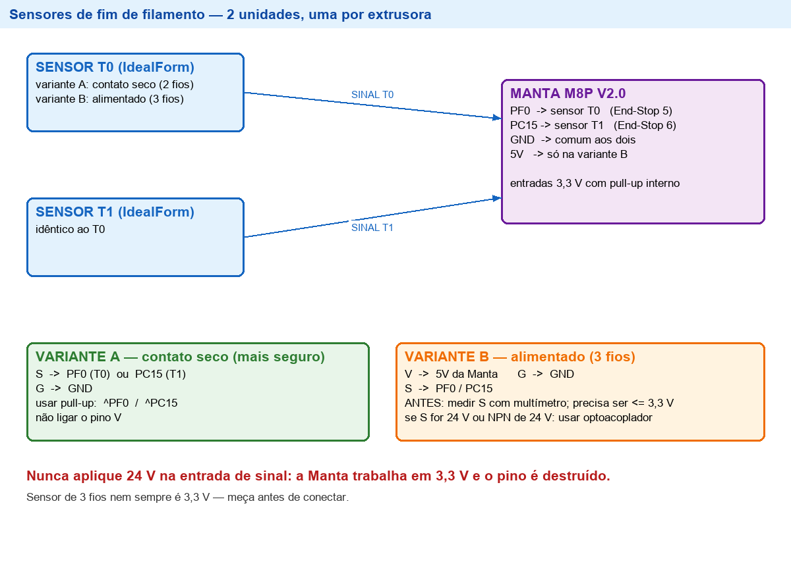

# Sensores de Fim de Filamento — 2 × IdealForm

**Documento:** 16_Sensores_Filamento.md
**Versão:** 1.0.0
**Data:** 2026-10-27
**Objetivo:** instalar um sensor de fim de filamento por extrusora, com parada automática apenas
quando a ferramenta ativa ficar sem material.

---

# 1. Pinos na Manta M8P V2.0

A configuração de referência da própria BIGTREETECH reserva dois conectores para sensor de
filamento, e ambos estão **livres** na configuração atual da máquina:

| Sensor | Pino do MCU | Conector na placa (referência BTT) | Usado hoje por |
|---|---|---|---|
| T0 (extrusora 0) | **PF0** | End-Stop 5 | — livre |
| T1 (extrusora 1) | **PC15** | End-Stop 6 | — livre |

Referência: [`06_Firmware/generic-bigtreetech-manta-m8p-V2_0.cfg`](../06_Firmware/generic-bigtreetech-manta-m8p-V2_0.cfg)
linhas 77–92.

Entradas de fim de curso da Manta: **3,3 V**, com pull-up interno disponível (`^`).

# 2. Diagrama



# 3. Duas variantes de sensor — descubra qual é o seu antes de ligar

## 3.1 Variante A — contato seco (2 fios)

É o caso mais comum e o mais seguro: o sensor é só um interruptor.

| Fio do sensor | Ligar em |
|---|---|
| S (sinal) | `PF0` (T0) ou `PC15` (T1) |
| G (terra) | `GND` |
| V | **não conectar** |

No Klipper, use o pull-up: `switch_pin: ^PF0`.

## 3.2 Variante B — alimentado (3 fios)

| Fio | Ligar em | Observação |
|---|---|---|
| V | **5 V** da Manta | nunca 24 V |
| G | `GND` | |
| S | `PF0` / `PC15` | **medir antes** |

**Procedimento obrigatório antes de conectar o sinal:**

1. Alimente o sensor com 5 V e GND.
2. Meça S em relação ao GND, com filamento presente e ausente:
   - **0 V / 3,3 V** → compatível, ligar direto;
   - **0 V / 5 V** → usar divisor resistivo ou optoacoplador;
   - **24 V** ou saída NPN de 24 V → **obrigatório optoacoplador**.
3. Confirme também se o sensor é **NA** (fecha com filamento) ou **NF**. Se a lógica sair invertida,
   o `switch_pin` recebe `!` — por exemplo `^!PF0`.

> A Manta trabalha em 3,3 V. Aplicar 5 V ou 24 V no pino de sinal o destrói.

# 4. Configuração no Klipper

Criar `qidi_xpro/filament.cfg` e incluí-lo no `printer.cfg`:

```ini
########################################
# Sensores de fim de filamento
########################################

[filament_switch_sensor fil_t0]
switch_pin: ^PF0
pause_on_runout: False
event_delay: 3.0
runout_gcode:
    
        M118 Fim de filamento no T0
        PAUSE
    
        M118 Sensor do T0 sem filamento (ferramenta inativa)
    
insert_gcode:
    
        M118 Filamento reposto no T0
        RESUME
    

[filament_switch_sensor fil_t1]
switch_pin: ^PC15
pause_on_runout: False
event_delay: 3.0
runout_gcode:
    
        M118 Fim de filamento no T1
        PAUSE
    
        M118 Sensor do T1 sem filamento (ferramenta inativa)
    
insert_gcode:
    
        M118 Filamento reposto no T1
        RESUME
    
```

## Por que `pause_on_runout: False`

Com duas extrusoras, a pausa automática do Klipper dispara mesmo quando o sensor da ferramenta
**inativa** abre — o que interromperia uma impressão boa por causa do bico que nem está em uso.
Desligando a pausa automática e tratando no `runout_gcode`, só há pausa quando a ferramenta
**ativa** é a que ficou sem filamento.

O `insert_gcode` só retoma se o trabalho estiver realmente pausado, para não gerar erro de
`RESUME` fora de pausa.

# 5. Teste

| # | Comando / ação | Esperado |
|---|---|---|
| 1 | `QUERY_FILAMENT_SENSOR SENSOR=fil_t0` | `filament detected` com filamento |
| 2 | Retirar o filamento do T0 | `runout` registrado no console |
| 3 | `QUERY_FILAMENT_SENSOR SENSOR=fil_t0` | `filament not detected` |
| 4 | Repetir 1–3 no `fil_t1` | idem |
| 5 | Com um trabalho pausado, repor o filamento | `RESUME` automático |
| 6 | Imprimir com T0 e retirar o filamento do **T1** | **não** deve pausar; mensagem de inativa |

# 6. Cuidados

1. **Meça o sinal antes de conectar** — o item 3.2 não é opcional.
2. **Não compartilhe o GND de forma errada**: o GND do sensor deve ser o mesmo da Manta.
3. **Roteamento**: os fios do sensor passam pela região dos cabos dos hotends; prender junto ao
   feixe existente e manter longe do cabo do termistor (ruído).
4. **`event_delay: 3.0`** evita falso disparo quando o filamento oscila no sensor.
5. Se a leitura sair invertida, trocar `^PF0` por `^!PF0` (e o equivalente no T1).

# 7. Pendências

- [ ] Confirmar se o IdealForm tem 2 ou 3 fios e qual a tensão de saída
- [ ] Definir o `switch_pin` com ou sem `!` conforme a lógica do sensor
- [ ] Instalar `qidi_xpro/filament.cfg` e incluir no `printer.cfg`
- [ ] Executar o teste da seção 5 e registrar
- [ ] Sincronizar o espelho `03_Klipper_Config/` e o `MANIFEST`
